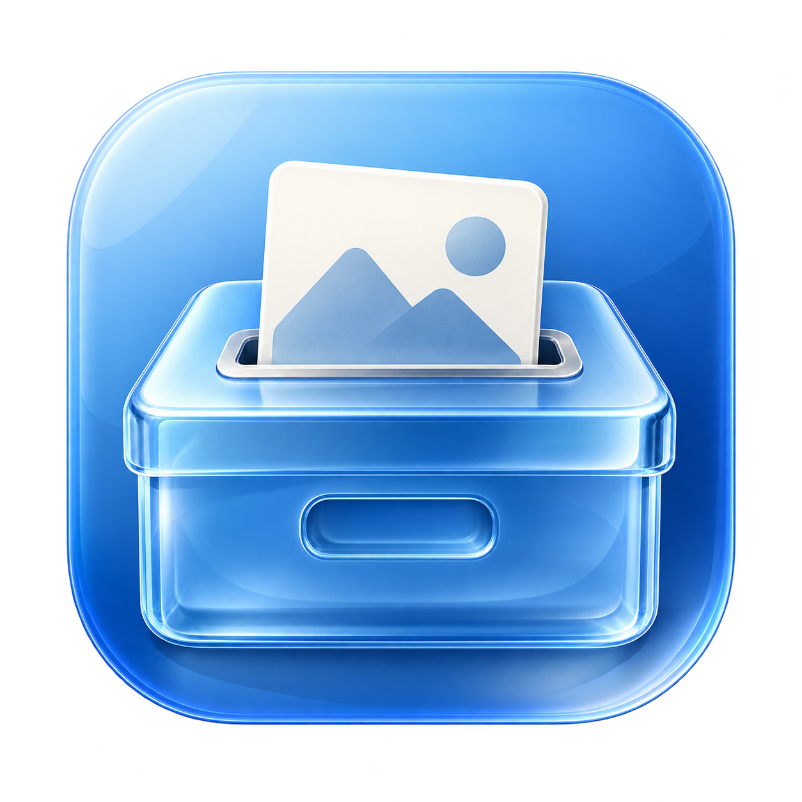
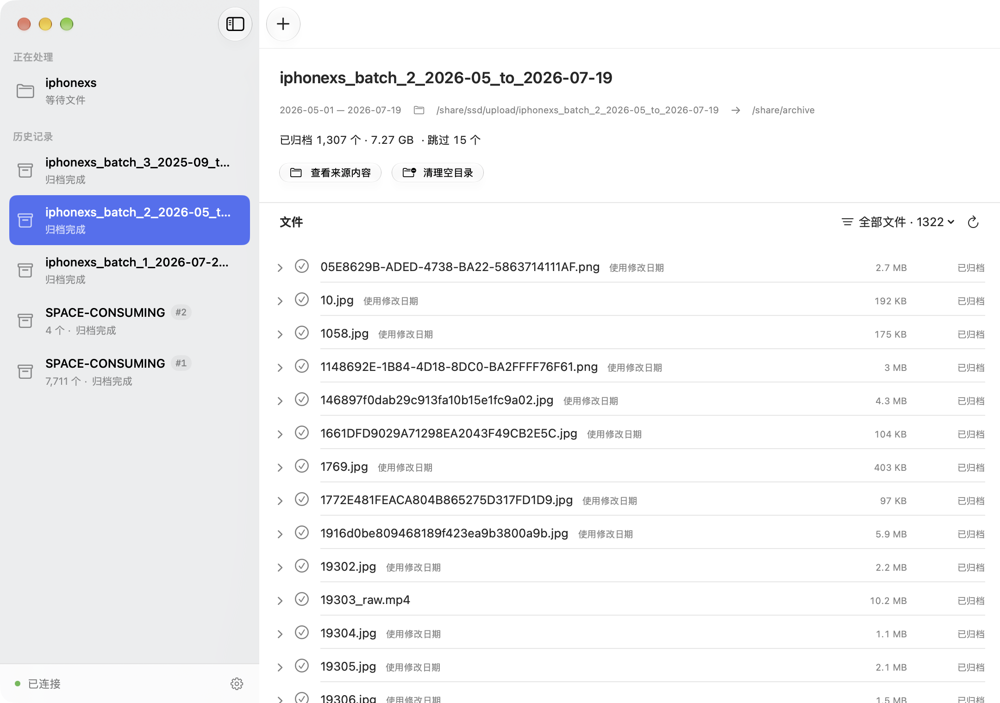
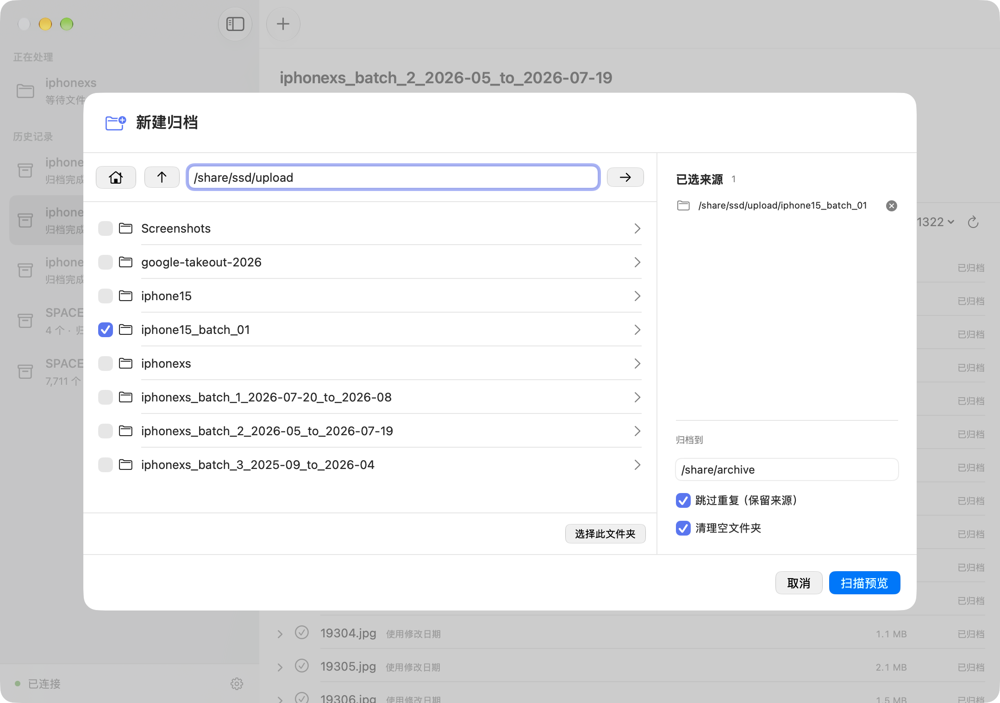
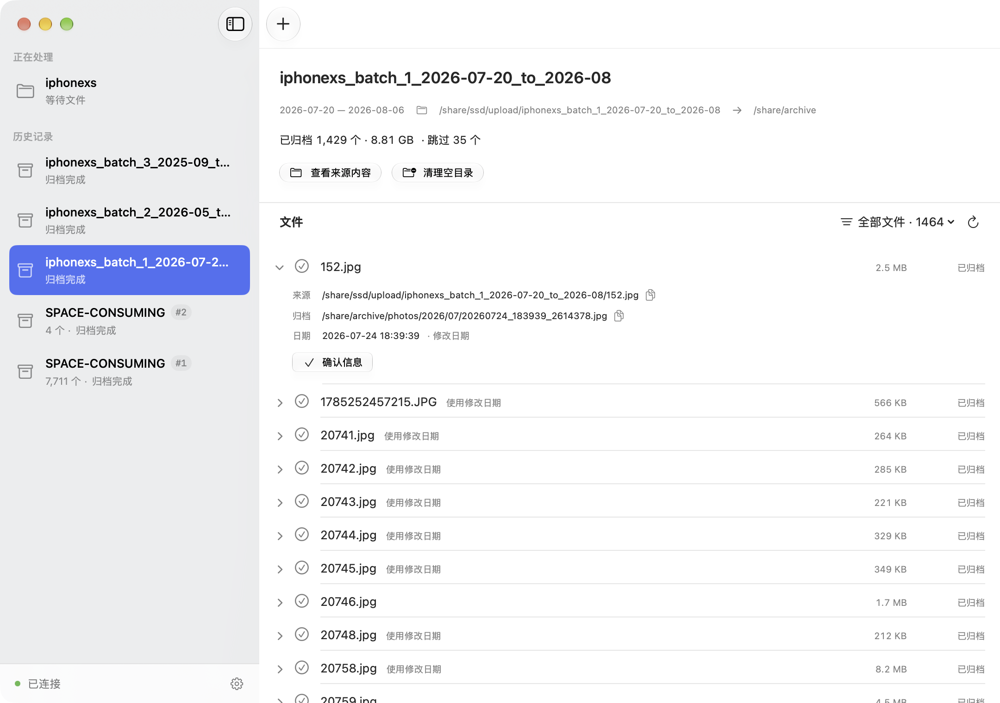
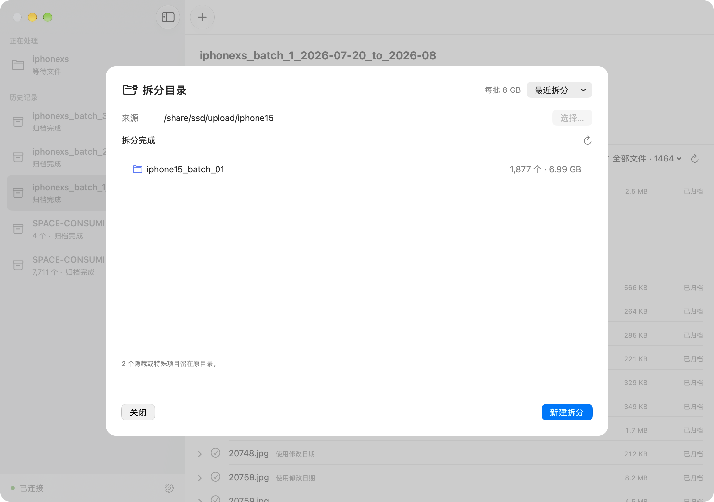

<p align="center">
  
</p>

<h1 align="center">NAS Archiver</h1>

<p align="center"><strong>在 Mac 上整理 NAS 照片，按日期归档，按大小分批。</strong></p>

<p align="center">
  <a href="#开始使用">开始使用</a> ·
  <a href="#先看预览再开始归档">功能介绍</a> ·
  <a href="#按-8-gb-拆成上传批次">拆分上传批次</a> ·
  <a href="https://github.com/yangyao/nas-media-archiver/issues">反馈问题</a>
</p>

手机照片、视频和导出的备份文件，常常堆在 NAS 的上传目录里。NAS Archiver 帮你把它们整理成按年月排列的资料库：选择目录、查看预览、确认归档，还能把大目录拆成便于上传网盘的批次。

**原生 Mac 应用 · QNAP NAS / Linux · 文件在服务端处理 · 开源免费**



## 先看预览，再开始归档

在 Mac 上浏览 NAS 目录，可一次选择多个来源。先扫描，查看文件数量、总大小、日期范围和需要关注的项目，再决定开始。

扫描只生成预览。确认开始后，服务端先复制并校验内容，成功后移除来源文件，完成归档。开始前还可以重新扫描，把后来新增的文件纳入这次预览。

归档会排除常见的 NAS 缩略图、回收站和 Syncthing 系统目录。



## 让照片和视频按时间归位

根据文件名和媒体信息识别拍摄日期，将照片、PNG 和视频分开，按年、月存放。GIF 保留原始动画，照片和视频保持原始内容。

```text
archive/
├── photos/
│   └── 2026/07/       照片、GIF 等图片
├── pngs/
│   └── 2026/07/       PNG 图片
└── videos/
    └── 2026/07/       视频
```

找不到拍摄日期时，会使用文件修改日期并提示。展开文件即可核对来源、归档位置和日期；路径旁的图标可直接复制地址，尚未开始归档的文件也可以手动修改日期。



## 减少重复占用，保留处理依据

默认开启“跳过重复”：先查找拍摄时间、大小和扩展名匹配的候选，再确认内容完全相同。确认重复后，归档中已有的文件保留，来源文件也保留，本次不再复制。

遇到目标同名但内容不同的文件时，会另存，不覆盖原文件。通过文件筛选查看跳过、失败和需要关注的项目，逐个核对处理结果。

| 你遇到的情况 | 可以怎么处理 |
| --- | --- |
| 日期缺失或需要核对 | 查看日期来源，开始前设置日期，或确认提示信息 |
| 归档失败 | 查看错误及来源文件，处理原因后重试 |
| 来源目录还有内容 | 直接浏览残留文件；重复、失败和不支持的文件会留下 |
| 上传目录已清空 | 清理空文件夹，其他内容保留 |
| 同一目录又放入了新文件 | 新建归档任务；同名历史任务用 `#1`、`#2` 区分 |

## NAS 继续工作，Mac 随时查看

归档时一起显示文件数量和数据量进度，可以暂停、继续，或在失败后重试。历史记录保留每次任务的结果，便于回头核对。误加或不再需要的未开始、已完成任务，可在任务右键菜单中删除记录，来源和归档文件保留。

关闭 Mac 应用后，服务端任务仍会继续。再次连接即可查看进度；也可以在应用设置中开启完成通知，选择浅色、深色或跟随系统的外观。

## 按 8 GB 拆成上传批次

准备分批上传网盘时，打开 **工具 → 拆分目录**，选择目录、预览批次，再点击开始。

批次名称自动沿用来源目录名，使用下划线和编号，放在原目录旁边：

```text
upload/
├── iphone15/              原目录保留
├── iphone15_batch_01/
├── iphone15_batch_02/
└── iphone15_batch_03/
```

- 每批最多 **8 GB**；不足 8 GB 也会生成一个批次。
- 文件保持完整，保留内部目录结构；单个文件超过上限时独立成批并提示。
- 隐藏同步项目留在原处，已有批次不会覆盖，编号自动顺延。
- 可以查看进度、重新打开最近记录，中断后继续执行。



拆分完成后，使用你自己的同步或网盘工具上传这些目录。[查看拆分使用说明 →](docs/directory-splitting.md)

## 开始使用

1. **安装归档服务**：在 QNAP 上安装 QPKG，或在 Linux 主机上运行服务。
2. **连接 Mac 应用**：填写服务地址和服务端生成的连接密码（Token）。
3. **设置目录**：首次连接未配置的服务时，选择允许归档的来源范围和默认归档位置。以后可在连接设置中修改。
4. **开始整理**：点击工具栏的 `＋` 新建归档；需要准备上传批次时，打开“工具 → 拆分目录”。

**[安装与连接指南 →](docs/getting-started.md)**

Mac 客户端需要 **macOS 26 或更新版本**。当前 QNAP 安装包面向 **ARM64 机型（如 TS-216）**；服务端也可独立运行于 Linux。当前仓库尚未发布可直接下载的安装包，可按安装指南自行构建。

## 支持的文件

| 类型 | 格式 |
| --- | --- |
| 照片和图片 | JPG / JPEG、HEIC、WebP、GIF |
| PNG 图片 | PNG |
| 视频 | MP4、MOV、3GP |

无法识别的格式会保留在来源目录，方便另行处理。拆分工具按文件大小分批，可处理上述媒体格式以外的普通文件。

## 常见问题

**这是把文件上传到云端吗？**

归档在你自己的 NAS 或 Linux 服务上完成；拆分工具负责准备批次，上传由你已有的工具完成。

**跳过的重复文件为什么还在来源目录？**

这是默认的保留来源策略。确认与归档中候选文件内容相同后，只跳过这次归档，不删除来源。

**断线或退出应用会影响任务吗？**

退出 Mac 应用不影响服务端运行。服务端异常重启后，可检查任务并继续或重试；尚未开始的归档预览可以重新扫描。

## 更多文档

- [安装与连接](docs/getting-started.md) · [拆分目录](docs/directory-splitting.md)
- [命令行、构建与部署](docs/development.md) · [QNAP 安装细节](docs/qnap-install.md)
- [API](docs/service-api.md) · [代码结构](docs/repository-layout.md) · [验证记录](docs/validation.md)

截图来自实际运行的 Mac 应用，目录和任务仅用于展示界面。

[MIT 开源许可证](LICENSE)
