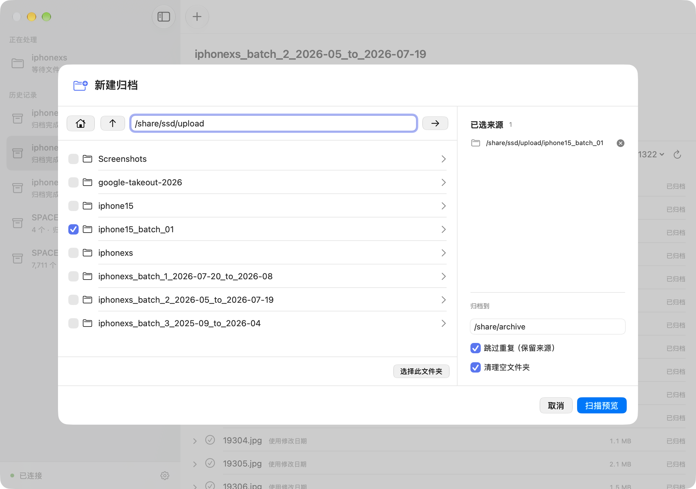

# 安装与连接

NAS Archiver 由安装在 NAS / Linux 上的归档服务和 Mac 应用组成。
安装一次服务后，日常选择目录、查看进度和修改归档位置都可以在 Mac 上完成。

目前仓库尚未发布安装包。自行构建请参阅[构建与部署](development.md)，
QNAP 包的构建步骤见 [QNAP 安装细节](qnap-install.md)。

## 1. 安装归档服务

### QNAP NAS

当前 QPKG 面向 ARM64 QNAP（例如 TS-216），需要 QTS 5.0 或更新版本。
在 App Center 中使用“手动安装”，选择构建生成的 `.qpkg`。
安装后，先由管理员检查服务端口及允许访问的目录，再启用服务。

新安装的基础配置为：

```sh
LISTEN="0.0.0.0:8787"
ROOTS="/share"
ARCHIVE_BASE=""
```

`ROOTS` 是管理员允许服务访问的范围，可以缩小到指定共享文件夹。
默认归档位置留空，稍后在 Mac 上选择；已有安装的目录配置会保留。
若 `8787` 已被其他服务占用，需调整端口，并在客户端使用对应地址。

详细的配置文件位置、启动方式及权限说明见 [QNAP 安装细节](qnap-install.md)。

### Linux

按[部署步骤](development.md#启动服务)启动服务，设置监听地址、持久化数据目录和允许访问的目录范围。
服务端应具有读取和移除来源文件、写入归档位置的权限。

## 2. 安装并连接 Mac 应用

Mac 应用需要 macOS 26 或更新版本。把构建得到的 `NASArchiver.app` 放入“应用程序”后打开。
首次连接时填写：

| 项目 | 填写内容 |
| --- | --- |
| 服务地址 | 例如 `http://你的NAS地址:8787`，使用实际配置的端口 |
| 连接密码 | 服务端生成的 Token，由服务管理员提供 |

Token 保存在服务端持久化数据目录的 `token` 文件中。它不是 QTS 账号密码，也不是 Mac 登录密码。
客户端会在本机保存连接密码，下次使用不必重复输入。
允许 macOS 的“本地网络”访问后，点击“连接”。

## 3. 选择来源与归档位置

服务尚未配置时，连接后会打开“归档设置”：

- **来源目录**：允许从哪些文件夹选择归档内容，可添加多个。
- **归档位置**：长期存放照片和视频的目录。

可以浏览管理员开放的目录。保存时会检查目录权限及路径冲突，来源与归档位置不能相互包含。
设置保存在服务端，对连接该服务的客户端共同生效。

以后可从主窗口左下角进入连接设置，点击“归档目录设置”；
也可在 Mac 的应用设置中打开。任务正在扫描、归档或拆分时，需等待停止后再修改。

## 4. 完成第一次归档

点击主窗口工具栏的 `＋`，选择一个或多个来源文件夹，检查归档位置和选项，点击“扫描预览”。



扫描不会移动文件。先核对数量、日期范围及需要关注的项目，确认后点击“开始归档”。
开始后可查看进度、暂停和继续。归档完成后，可浏览来源残留内容，按需清理空文件夹。

默认启用“跳过重复（保留来源）”：内容相同的候选文件不再复制，来源继续保留。

## 准备网盘上传批次

打开“工具 → 拆分目录”，选择来源目录并预览。
目录名会自动生成 `iphone15_batch_01` 这样的平级批次名称，确认后再开始。

拆分和归档是两个独立操作。详见[拆分目录说明](directory-splitting.md)。

## 连接遇到问题时

- 检查归档服务是否已启用，Mac 与 NAS / Linux 是否能够互相访问。
- 确认填写的是归档服务的地址和端口，而不是 QTS 管理页面或 SSH 端口。
- 密码错误时，重新取得该服务的 Token；不要填写 Mac 或 QTS 的登录密码。
- 浏览或保存目录失败时，检查服务运行账号的权限及管理员设置的访问范围。

局域网 HTTP 连接应在可信网络中使用；需要跨不可信网络访问时，由管理员配置 HTTPS 或安全隧道。
